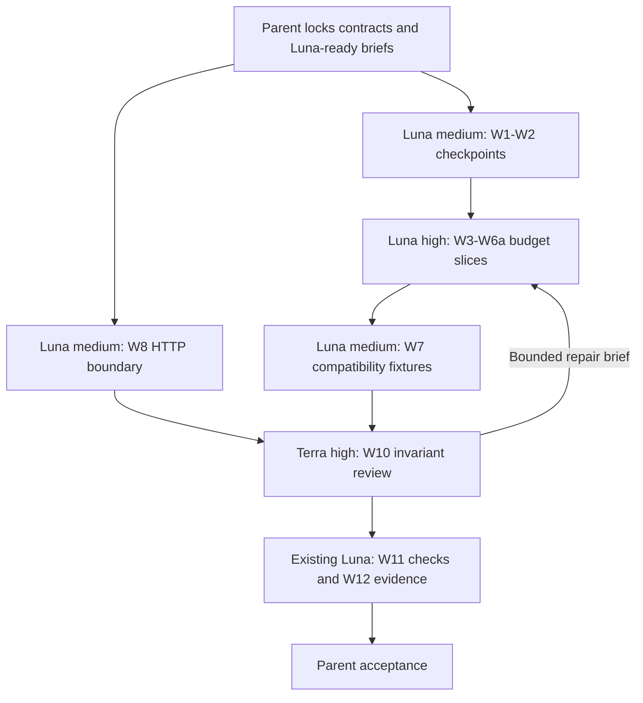

# Next roadmap iteration — R0 reliability

Status: local implementation, review and gate complete · Updated: 2026-11-11
Baseline: `ba94404` plus existing working-tree edits; preserve those edits.
Coverage: local repairs in R0-10–R0-14. G0, G1 and audit 32 remain open.

**Subsequent planning addition:** [R0-15 Stow workspace integration](stow-workspace-integration.md)
records the generic-store/shared-directory mismatch and its native startup/recovery
acceptance. It is planned work outside the completed repair scope below; prior
local gates do not verify it. The roadmap adds it to G0 without reopening the
alternative-runtime investigation.

Execution checkpoint: W1–W9, W10 independent review, W11 local gate and W12 evidence
publication are complete. The final gate passed with 212 unit tests/34 files, 100 Worker
tests/26 files, config/type/build and diff checks. No deployment, live provider/Slack,
or fresh real-container validation was performed. R0-11 is partial; F1/F2, G0/G1 and
audit 32 credential isolation remain open at that first repair checkpoint. Later F1
sections below supersede its accounting deferrals. The next scoped work is
[F2 held-turn recovery](r0-held-turn-reconciliation.md), now implemented and verified
locally for its explicitly recoverable cases.

## 1. Mission

**Intent:** repair the reproduced checkpoint, reservation and JSON failures with
small changes to existing code and permanent regressions.

**Why:** the previous plan expanded a local repair into an accounting/recovery
redesign. Minimize total tokens by reducing implementation scope, repeated context,
agent handoffs and review loops while retaining meaningful failure checks.

## 2. Key results

| ID | Outcome |
|---|---|
| KR1 | More than five checkpoint updates preserve all active references; missing declared parts cause zero destructive restore calls. |
| KR2 | Two $0.10 acquisitions under $0.10 available budget grant one; startup-failed queued work later dispatches once without a self-blocking hold. |
| KR3 | Only the current hold owner can release it; uncertain dispatch, missing usage or unconfirmed stop keeps the hold visible and prevents automatic re-prompt. |
| KR4 | Invalid consumed public JSON returns 400 before mutation; valid request contracts still pass. |
| KR5 | Focused independent review and required local checks pass; documentation distinguishes repaired reproductions from deferred recovery/accounting guarantees. |

## 3. Assumptions (stated)

- Local implementation was authorized and completed. No deployments, real credentials,
  messages, billable model tasks or live migrations were part of this execution.
- Reuse the current checkout, Settings request queue, actual-usage ledger, existing
  conversation lifecycle and tests. One active turn plus one queued message remains.
- Keep the $0.10 admission estimate, UTC days and budget-zero opt-out. An estimate
  does not cap the eventual cost of a running model task.
- Initial use is trusted-operator/trusted-repository only. Model effectiveness and
  real container/Slack/OAuth behavior remain unmeasured by the local assessment.
- A smaller next iteration does not close every R0-11 acceptance criterion. Broader
  accounting/recovery work below stays explicit; G0 does not close on local tests.

## 4. Locked design decisions

| Decision | Choice |
|---|---|
| Checkpoints | Preserve names, encryption and manifest format. Paginate enumeration; keep five per recognized class plus all current references; leave unknown names alone. Narrowly serialize publication/pruning. |
| Restore | Preflight every declared part before destructive calls. A broken manifest fails visibly; intentionally omitted state is valid. Preserve proven no-manifest legacy paths; do not guess split pairs from filenames. |
| Atomic budget | Extend the existing serialized Settings reserve handler: validate identity/amount, read actual plus held spend, then grant/write together. No new coordinator or service. |
| Ownership | One hold per active conversation, guarded by a generated `reservationID` plus Settings-assigned originating date. Persist the proposed ID locally before acquisition and the returned reference before prompt dispatch. Same-owner retry finds the same hold across midnight; another unresolved owner cannot be replaced. Queued work owns no hold. |
| Dispatch | Claim local admission and ready the session before reserve. Record “dispatch may have happened” durably before sending the prompt. Definitely pre-dispatch failures may queue/release; ambiguous outcomes retain ownership and do not enter generic requeue catches. |
| Release | Compare conversation, ID and originating date before deleting. Report obtainable terminal actual usage successfully before releasing. Confirmed stop is not proof of zero past cost. Keep pending ownership until acknowledgement; do not promote the next turn meanwhile. |
| Failure policy | No automatic TTL, extra arm endpoint or fabricated cancellation. Uncertain prompt acceptance, unreadable usage, failed stop or abandoned work remains visibly blocked for manual reconciliation. Existing alarms may inspect context; they cannot free a hold merely because time passed. |
| Reset/delete | Return a controlled conflict before erasing state while dispatched work or its usage remains unresolved. Resume normal reset/delete after acknowledged reconciliation; never drop the only local evidence while retaining an unexplained global hold. |
| Day boundary | Release uses the saved originating reference, not today's date. Outstanding unresolved holds remain counted across midnight and are excluded from age pruning. Source usage attribution across days is not repaired here. |
| Reporting | Separate actual `costUSD` from `reservedUSD`; expose `admittedUSD` as their conservative sum. Retain absolute actual-usage records and fix conversation counting. Do not claim billing-grade totals. |
| Public input | Small object-parsing helper; reject malformed/null/array bodies, then reuse route/domain validation. Authenticate/rate-limit first; validate before registry/provider writes. Keep bodyless actions and valid partial settings/provider objects. |
| Rollout | Local seeded legacy fixtures plus a documented quiesced cutover. Do not remove unknown legacy holds or support mixed old/new writers. No production migration in this iteration. |

Minimal internal contract (existing routes extended):

```ts
// POST /usage/reserve
{ conversationID, reservationID, costUSD: 0.10 }
// 200: same owned hold granted/reused; 429: budget unavailable;
// 409: another unresolved owner; malformed input: 400.
// Grant returns its Settings-assigned originating date; retry returns the same ref.
// Authority/network failure must stop dispatch, not grant permission to spend.

// POST /usage/release
{ conversationID, reservationID, date }
// Compare identity before deletion; stale release cannot remove a newer hold.

// Existing /usage remains an absolute per-conversation/day actual report.
// Check its response before retiring a terminal turn's hold.
// GET /usage/today adds reservedUSD/admittedUSD; costUSD is actual only.
```

**Deferred machinery:** no five-minute expiry/arm protocol, new `/usage/settle`
endpoint, receipt history, global usage revisions, automatic reset/day accounting
reconstruction or older-manifest recovery subsystem. F1: ordered/correct accounting
across delayed reports, resets and days. F2: automated reconciliation/expiry with
proof that dispatched work stopped. These require later scoped work before claiming
the broader guarantees in `docs/testing.md`; they are not silently marked complete.

## 5. Orchestration pattern

**Luna implementation batches, parent design decisions, focused independent review.**
Work IDs are bounded briefs, not necessarily new launches. Sequence shared-file work;
parallelize the disjoint HTTP boundary where useful.



## 6. Team and subtasks

| ID | Role | Model tier | Exact model / reasoning | Goal | Success criterion |
|---|---|---|---|---|---|
| C | Checkpoint/helper owner: W1/W2/W7/W9/W11/W12 | mid | `gpt-6-luna` / medium | Bounded checkpoint edits, fixtures, checks and verified documentation | Each brief passes its observable check; reuse this context for routine follow-through |
| B | Budget owner: W3/W4/W4a/W4b/W4c/W5/W6/W6a | mid; high effort for specified local state changes | `gpt-6-luna` / high | Implement the locked hold contract one handler/helper at a time | KR2/KR3 pass; no unrequested architecture or guessed contract |
| H | HTTP boundary owner: W8 | mid | `gpt-6-luna` / medium | Apply the specified JSON validation contract | KR4 with valid-client behavior preserved |
| R | Independent reviewer: W10 | large | `gpt-6.1-terra` / high | Review interleavings across ownership, dispatch, settlement and restore | No unresolved critical defect; this cross-cutting judgment warrants stronger review |
| P | Parent orchestrator | current chat | Current parent; no new model invocation | Lock contracts, prepare briefs, sequence owners and accept results | Luna is not asked to resolve an open architectural decision while implementing |

Luna is the default, including code changes, regressions, checks and documentation.
Available overrides were checked against the live tool: `gpt-6-luna`, `gpt-6.1-sol`,
`gpt-6.1-terra`, `gpt-6-astra`, `gpt-6-sol`. Do not assign Sol to an entire workstream
merely because several small changes share a file. Higher consequence requires a
precise brief and appropriate review, not necessarily a larger implementation model.

Use `fork_turns: "none"` with explicit model/effort for new agents. Reuse C/B/H for
sequential IDs; send one bounded brief per slice with target functions, locked
choices, an existing example, owned files and its check. At most three children
are active; C and H can start together, B waits for C's Conversation handoff.

If Luna is blocked, parent first supplies missing context or narrows the task.
After two unsuccessful bounded attempts, route only the remaining design/debugging
question to `gpt-6.1-sol` / high, then return specified edits to Luna. Astra/high is
reserved for a question Sol cannot resolve. If Terra is unavailable, fresh Sol/high
can perform the same scoped critical review. Record unavailable model substitutions;
do not silently replace all Luna work with a larger model.

## 7. Subtask briefs

| Role | Inputs / ownership | Constraints | Handoff / done when |
|---|---|---|---|
| C | Checkpoint functions/tests for W1/W2; later exact W7 fixture or W9/W11/W12 targets | Own Conversation only through W2, then hand it to B. Routine follow-up stays in this Luna context. | Changed files, check summary and concrete blocker; about 200 words plus paths. |
| B | Relevant named Settings/state/Conversation functions and existing fixtures | W3 sets reserve authority; W4 defines the shared dispatch helper; W4a/b/c bind one transport each. W5/W6/W6a handle specified lifecycle branches. No concurrent Conversation writer. | Per-slice diff/check and unresolved decision; do not take the whole budget feature as one open-ended task. |
| H | JSON helper example; public message/permission/settings/integration boundaries | Own `index.ts`/`settings.ts`; do not edit Conversation or Settings DO. Preserve bodyless and valid partial requests. | Focused invalid-body and valid-client outcomes; report missing contract before guessing. |
| R | Introduced diff, affected assertions, KR1–KR4 | Read-only. Check active references, owned deletion, unknown dispatch, acknowledged reporting and invalid-input side effects. | Actionable source-linked defects or acceptance, about 250 words. |
| P | Existing research, proposed contracts and agent handoffs | Split unresolved architecture from implementation. Accept each slice before the next ownership handoff. | Decisions and final acceptance; delegate bounded evidence edits/checks to reusable Luna contexts. |

**Luna-ready brief:** concrete output; exact files/functions; necessary context or
example; already-settled decisions; allowed writes; one observable acceptance check.
Split again if those cannot be stated without a cross-cutting design exercise.
Prefer roughly 300-word briefs and short handoffs, not pasted repositories/chats.
Save verbose logs locally and read only relevant failure excerpts. One initial
independent review plus a focused recheck for consequential fixes; more research
requires a named uncertainty that would change code or remove work.

## 8. Individually enumerated backlog

W1–W12 are complete as local work products, with an adjacent regression for each
implemented source slice and an independent cross-path review. Keep the original model
assignments and per-slice traceability as the execution record. The local evidence does
not close deferred F1/F2, G0/G1, audit 32 or live/container validation.

| ID | Work | Agent role (subagent_type) | Model tier | Model / reasoning | Depends on | Done when |
|---|---|---|---|---|---|---|
| W1 | Protect checkpoint references | Checkpoint/helper owner (`spawn_agent`, reused) | mid | `gpt-6-luna` / medium | — | >5 updates, old active parts, pagination, unknown names and concurrent publication preserve active objects. |
| W2 | Preflight split restore | Checkpoint/helper owner (`spawn_agent`, reused) | mid | `gpt-6-luna` / medium | W1 | Missing declared parts cause zero restore/seed/configure/start calls; stateless and proven legacy fixtures still pass. |
| W3 | Enforce atomic owned reservation | Budget owner (`spawn_agent`, reused) | mid; bounded high effort | `gpt-6-luna` / high | W2 | Concurrent $0.10 requests under $0.10 grant one; retry is idempotent; conflicting owner, nonfinite amount and unavailable authority reject. |
| W4 | Add the specified dispatch helper | Budget owner (`spawn_agent`, reused) | mid; bounded high effort | `gpt-6-luna` / high | W3 | Implement one agreed ownership helper around the existing admission/readiness/hold path; helper fixtures cover pre-dispatch failure and authority rejection. Parent locks its interface before this implementation brief. |
| W4a | Bind HTTP admission | Budget owner (`spawn_agent`, reused) | mid | `gpt-6-luna` / high | W4 | Patch only `onMessage` to use the agreed helper; startup failure queues with no hold, duplicate requests preserve idempotency, rejected acquisition prompts zero times. |
| W4b | Bind Slack admission | Budget owner (`spawn_agent`, reused) | mid | `gpt-6-luna` / high | W4a | Patch `onSlackEvent` against the same helper; mocked Slack denial/readiness failure preserves dedupe and creates no waiting hold. |
| W4c | Bind queue drain | Budget owner (`spawn_agent`, reused) | mid | `gpt-6-luna` / high | W4b | Patch `drainQueue`; the original queued $0.10 case dispatches once after readiness and acquires exactly one owned hold. |
| W5 | Release after terminal usage acknowledgement | Budget owner (`spawn_agent`, reused) | mid; bounded high effort | `gpt-6-luna` / high | W4c | Existing absolute usage report succeeds before owned release; reporting/release failure blocks promotion; stale A cannot release B; delivery retry never prompts again. |
| W6 | Block uncertain automatic replay | Budget owner (`spawn_agent`, reused) | mid; bounded high effort | `gpt-6-luna` / high | W5 | Durable dispatch marker survives restart; ambiguous prompt error/timeout/unconfirmed stop retains hold and blocks re-prompt; originating-date release and age-prune exceptions pass. Manual resolution limit is explicit. |
| W6a | Guard destructive reset | Budget owner (`spawn_agent`, reused) | mid | `gpt-6-luna` / high | W6 | Patch reset/delete guards only: unresolved dispatch/usage returns a controlled conflict before evidence is erased; reconciled reset/delete retains current behavior. |
| W7 | Check legacy hold compatibility | Checkpoint/helper owner (`spawn_agent`, reused) | mid | `gpt-6-luna` / medium | W6a | Seeded legacy actual totals remain intact; unresolved old holds stay visible/countable; quiesced-cutover/backout steps documented, without building an automatic migration tool. |
| W8 | Reject invalid public JSON | HTTP owner (`spawn_agent`, reused) | mid | `gpt-6-luna` / medium | W7 | Consumed message/permission/settings/integration bodies return controlled 400 before mutation; valid contracts and bodyless actions preserved. |
| W9 | Correct credential-check wording | Checkpoint/helper owner (`spawn_agent`, reused) | fast | `gpt-6-luna` / medium | — | Reuse existing synthetic evidence; runbook calls literal-path checks permission checks, not credential isolation; audit 32 stays open. |
| W10 | Review changed recovery paths | Reviewer (`spawn_agent`, fresh) | large | `gpt-6.1-terra` / high | W7, W8 | KR1–KR4 checked against code/assertions; no unresolved critical issue; broader inferred accounting risks remain deferred and disclosed. |
| W11 | Run local gate | Checkpoint/helper owner (`spawn_agent`, reused) | fast | `gpt-6-luna` / medium | W10 | Run prescribed local gate in the reused Luna context; return counts and failure excerpts; parent evaluates failures. Do not redesign failing code while acting as runner. |
| W12 | Publish evidence | Checkpoint/helper owner (`spawn_agent`, reused) | fast | `gpt-6-luna` / medium | W9, W11 | Roadmap/audit/testing/boundary/runbook agree on verified fixes, partial R0-11 and open G0/G1/audit32; links pass. |

C hands Conversation to B after W2; H may work on disjoint public input files.
W9 is a bounded doc subsection and can follow W2 in C's context. Final checks/docs
wait for review; no simultaneous shared-file writer. Group context by coherent
inputs while keeping individual changes small enough for Luna.

## 9. Scope (hard)

**In:** W1–W12, preserving original reproductions and conservative failure behavior.
**Out:** F1/F2 above, R1 extraction/tenancy/egress, new security diagnostics duplicating
existing evidence, actual credential isolation, UI redesign, automatic migration,
production deployment, live model/Slack/OAuth work and provider billing guarantees.

| Surface | Limit |
|---|---|
| Budget | Global estimate-based admission; existing actual ledger; one owned active hold; no queued hold |
| Recovery | Missing checkpoint fails visibly; unknown dispatched work may require manual resolution |
| APIs | Existing internal routes extended; public usage clarifies measured/held totals |
| Storage | Existing DO/R2; small additive ownership/dispatch fields; no key rewrite |
| Release readiness | Original reproductions can close with evidence; R0-11 remains partial until broader criteria are separately verified |

## 10. Risks and backout

| Risk | Response |
|---|---|
| Simpler holds can remain blocked after crashes | Deliberate conservative tradeoff; show ownership/error and manual-resolution guidance. Never clear on time alone. F2 owns automation. |
| Late/reset/day usage reports are inaccurate | Existing/inferred accounting limitation, not fixed here. Keep F1 and broader R0-11 criteria open; do not describe results as billing-grade. |
| Legacy filenames/records are ambiguous | Preserve established paths; unknown manifests/holds fail visibly and remain retained. No guessed pairing or automatic deletion. |
| Rollback loses awareness of new holds | Quiesce admissions; reconcile obtainable usage and confirmed stops before code rollback. Preserve unresolved records; do not flip off the budget to bypass them. |
| Dirty tree obscures unrelated edits | Capture starting diff, inspect introduced hunks, never blanket reset/revert. |

No production migration is authorized. The release unit includes all budget callers
and Settings changes together; isolated W3 must not be deployed. Checkpoint/input
repairs remain separately reviewable. A revert reopens the relevant finding.

## 11. Rubric / acceptance

| Result | Required evidence |
|---|---|
| KR1 | Existing checkpoint suites extended for retention/preflight and simulated cold restore |
| KR2 | Original self-blocking/concurrent-reservation cases now assert desired behavior through authority and caller paths |
| KR3 | Failure injection before/after dispatch, report failure, stale release, restart, timeout and midnight; unresolved work never silently freed/replayed |
| KR4 | Malformed `{`, null, arrays and invalid fields; registry/version/prompt/provider counters unchanged on rejection; valid-client fixtures retained |
| KR5 | Focused review + full local gate + evidence update; no unsupported closure of deferred guarantees |

Use deterministic clocks/barriers and existing fixture transports. Do not broaden
coverage merely to improve a percentage or rerun unchanged successful checks.

## 12. Verification

During implementation run only affected existing suites; add focused cases to those
files. A new helper test is justified only if the helper is actually introduced.
Suggested focused commands:

```sh
bun run test:workers test/checkpoint-split.test.ts test/checkpoint-integrity.test.ts test/checkpoint-encryption.test.ts
bun run test:workers test/budget-gate.test.ts test/usage-ledger.test.ts test/admission.test.ts test/idempotency.test.ts test/turn-settlement.test.ts test/reset.test.ts
bun test tests/settings.test.ts tests/budget.test.ts
bun run test:workers test/worker.test.ts test/auth.test.ts
```

The reused Luna helper runs the integrated gate after review; parent checks results.
Repeat only for a new change,
failure or unresolved concern:

```sh
bun run check:config
bun run typecheck
bun run build:ui
bun run test
bun run test:workers
git diff --check
```

Record actual counts, failures and environment limits, not full passing logs.
Check edited document links. Docker/live-provider tests are a later gate, not
silently substituted with injected responses. No such tests run during planning.

## 13. Deliverable

One integrated local repair set with regressions beside each implemented slice, an
independent review, and an evidence update. Do not commit unrelated changes or publish
a PR by default. R0-10/R0-13 and the original audit 30/31 cases pass their local checks;
R0-11 remains partial for deferred broader guarantees. Audit 32/G0/G1 stay open.
No numerical token-saving claim: reduced scope/context duplication is observable,
but actual model token use was not benchmarked.

## 14. Execution gate

Execution of the scoped local work is complete and accepted. The final local gate and
documentation update are recorded in [the testing evidence](../testing.md#local-repair-verification--2026-11-11)
and [the production audit](../production-audit.md#local-repair-verification--2026-11-11).
No production migration, deployment or live validation was performed or authorized by
this plan. The subsequently authorized F1 scope is recorded below; F2 and live
gates remain separate work.

## F1 accounting follow-up — 2026-11-11

Status: local implementation and verification complete, authorized by the user's
“Go”. The legacy/quiescence/live gates below remain open.

Matching OpenCode 2.2.5 source changed the design: `session.usage.updated` is a
lifetime session total **including** title and compaction costs. The previous
step-total interpretation could double count auxiliary calls. Its timestamp cannot
allocate that lifetime total across days. The pinned client exposes finite durable
session-log replay, including individual step and auxiliary usage events.

Use those durable events as actual-usage sources. Settings owns deduplication by
conversation/session/event ID, immutable UTC source dates and componentwise usage
high-water marks. Update each source and its daily aggregate in one transaction.
The caller advances a durable replay cursor only after acknowledgement and requires
the current terminal assistant's usage before releasing its hold. Cumulative stream
totals do not add money. Reset/session replacement cannot erase central source records.

Legacy nonzero aggregate rows have no source identities. Preserve them and reject
ambiguous mixed writes pending a separately verified cutover; never guess overlap
or silently erase historical spend. Existing zero rows can convert safely. Keep
30-day retention consistent between aggregates and sources; expired reports cannot
recreate pruned spend. Reservation ownership and release rules stay in force.

| Item | Owner/model | Acceptance |
|---|---|---|
| F1a | `luna_usage_research`, `gpt-6-luna` / medium | Verify matching upstream event semantics and finite replay contract |
| F1b | Parent + `accounting_contract`, `gpt-6.1-terra` / high | Lock source identity, atomic update and legacy boundary; stronger model resolves these accounting ambiguities only |
| F1c | `luna_usage_ledger`, `gpt-6-luna` / high | Settings source ledger with replay, concurrency, validation, midnight and legacy regressions |
| F1d | `luna_usage_caller`, `gpt-6-luna` / high | Durable replay, acknowledged cursor, terminal proof, source-day attribution and failure retries |
| F1e | Reused Luna context | Adapt existing provider fixtures; run integrated checks and record evidence |
| F1f | Reused Terra reviewer + parent | Review accounting/hold invariants; return bounded corrections to Luna |

No claim of billing-grade provider prices, historical legacy reconstruction or live
compatibility follows from mocked checks. F2, credential isolation and deployment
validation remain open.

Completed F1a–F1f: Luna implemented the source ledger, replay, fixtures and regressions;
the reused Terra reviewer accepted the named accounting/cleanup invariants. The
final integrated gate passed 213 unit tests in 34 files and 114 Worker tests in 27
files, plus configuration, typecheck, UI build and diff checks. See
[verification](../testing.md#f1-accounting-verification--2026-11-11).

Review corrections include denying legacy-conflicted admission before dispatch,
retaining terminal evidence when background replay consumes it first, and holding
the usage queue throughout reset/delete cleanup. Warm usage events, next admission
and pre-cleanup drains collect available late auxiliary records. A finite snapshot
does not establish that detached provider work cannot publish further charges.
Therefore F1's core replay/reset/day accounting is verified locally, while legacy
conversion and auxiliary-task quiescence remain explicit release gates. Keep
R0-11 partial. No staging calls, deployment or production migration occurred.

## F1 policy and legacy cutover — 2026-11-11

Status: local implementation, independent review and verification complete. No
production migration or deployment. F2 and live validation are separate.

**Research decision:** OpenCode 2.2.5 can start detached compaction immediately
before execution goes idle. Waiting for execution or a log watermark therefore
cannot drain it. The supported `experimental.background_compaction: false` setting
removes that path while keeping foreground automatic compaction. Disable the title
agent as well. Apply both through `OPENCODE_CONFIG_CONTENT`, then verify effective
config so administrator-managed overrides cannot silently restore detached usage.
A controller handshake identifies a process started with this policy; a missing
handshake requires an image upgrade rather than an inferred fence.

**Legacy boundary:** historical rows cannot be reconstructed exactly. Preserve
their recorded amounts as explicit, unreconciled opening balances. A cutover
receipt records the continuing session's durable-log watermark and an ordering
ID. Events through that watermark are covered by the opening boundary; future
events add normally. This does not establish that old reported amounts match old
provider bills. Show `historicalUsageUnreconciled: true` in the preview and receipt.

**Reviewable workflow:** authenticated
`GET /api/conversations/:key/accounting/cutover` previews opening balances, runtime
policy/generation, source session/watermark and blockers. It changes no accounting
records, cursor, hold or dispatch state; readiness may start infrastructure.
`POST` with `{ "expectedPlanID": "<preview hash>" }` revalidates under the existing
admission and usage queues. Active/queued work, any unresolved hold, unsafe runtime,
provider execution still running, incomplete log or a changed plan blocks apply.
The plan hash omits request timestamps and other unrelated counters.

Settings checks its ledger snapshot again and commits converted row markers plus
the receipt in one transaction. It never reduces an amount or releases a hold.
After cutover, absolute legacy reports and sourced reports with a missing/stale
ordering ID are rejected, including delayed requests. Replays fetch the central
receipt, so a crash or local reset cannot lose the boundary. Repeating the same
plan returns the same receipt. Receipt retention is independent of daily pruning.

| ID | Owner / model | Done when |
|---|---|---|
| F1g | Reused `luna_usage_research`, `gpt-6-luna` / medium | Exact-version lifecycle/config evidence resolves the fence without a new stop framework |
| F1h | Same Luna context | Fixed runtime policy, effective-config validator, process handshake and provider fixtures pass focused checks |
| F1i | Reused `luna_usage_ledger`, `gpt-6-luna` / high | Read-only inventory, atomic opening-balance cutover, snapshot conflict/idempotency and stale-writer regressions |
| F1j | Reused `luna_usage_caller`, `gpt-6-luna` / high | Preview/apply checks actual runtime and log boundary; changed/unsafe plans fail without accounting mutation; replay recovers receipt after crash |
| F1k | Reused Terra reviewer + parent | Review ordering, conservation and runtime-fence invariants only; return concrete corrections to Luna |
| F1l | Reused Luna context | Integrated existing gate and updated evidence; actual cutover/deployment remains unperformed |

Shared-file ownership is serialized. The parent locks contracts and integrates;
Terra is reserved for consequential cutover review, not ordinary implementation.
Escalate a named undecided invariant after improving the bounded brief, rather than
transferring the whole feature to a larger model.

Acceptance: opening balances and global budget headroom stay unchanged on apply;
pre-boundary replay cannot double count; post-boundary usage adds once; stale
writers cannot bypass the ordering ID; incomplete/active provider work cannot
produce an applicable preview; failed/stale apply leaves rows and holds intact;
retries and restart recover the same central receipt. Config checks reject a
managed override enabling detached billing. Existing reset/queue/settlement gates
must remain green.

Backout: quiesce writers and preserve opening balances, source records, receipts
and holds together. An aggregate-only writer does not understand the new ordering
fence. Do not remove it or rewrite historical amounts to make an older writer work.
No claims about unobserved historical billing, arbitrary code/third-party calls,
credential isolation or live compatibility follow from these local tests.

**Execution evidence:** F1g–F1l are complete locally. The final gate passed 217 unit
tests in 35 files and 134 Worker tests in 29 files (351 total), all four typecheck
configurations, config check, UI build and diff check. The verified official Darwin
2.2.5 binary also passed isolated config-override/title-agent checks without model
calls. Docker was unavailable; this is not Linux-container validation.

Review added regressions for receipt recovery across replacement sessions,
provider-log rollback, output-limit continuation through foreground compaction,
malformed execution fences, active settings changes without policy bypass/recycle,
and crash-interrupted fence reconstruction. Reconstructed cursor/terminal/execution
metadata commits together only after a validated sync point. Terra accepted the
final correction. See [latest verification](../testing.md#f1-policy-and-cutover-verification--2026-11-11).

The scoped F1 implementation is complete; historical bills remain unreconciled by
design. Actual cutover on quiesced live data, deployed image compatibility, F2 and
G0/G1 remain open. No actual cutover, deployment, Slack message, OAuth or model call
was performed.

## Next scoped work — F2

The [held-turn recovery plan](r0-held-turn-reconciliation.md) is implemented and
reviewed locally. It reuses current recovery/settlement and adds passive inspection,
guarded pre-dispatch cancellation and a permanent ID-retirement fence against
delayed acquisition. The latest gate passes 371 tests (222 unit, 149 Worker),
config/type/build and diff checks. Luna implemented and tested; Terra accepted the
invariants and focused acknowledgement-race correction. Legacy/orphan cases without
proof and live verification remain open; no actual production recovery or deployment
occurred. This later evidence supplements the completed F1 record.

## Sources and simplification record

- [Targeted simplification research](r0-simplification-research.md): local source,
  alternatives, minimal repair and remaining guarantees; no product changes.
- [Roadmap](../roadmap.md), [audit](../production-audit.md#local-repair-verification--2026-11-11),
  [testing criteria](../testing.md#required-regressions-before-g0),
  [boundary design](../design/r1-agent-boundary.md).
- Prior checkpoint/input reviews remain applicable. Budget scope above supersedes
  the earlier full arm/expiry/receipt/revision design; Luna-first assignment supersedes
  the research note's one-workhorse execution suggestion. Keep narrow completion claims.
