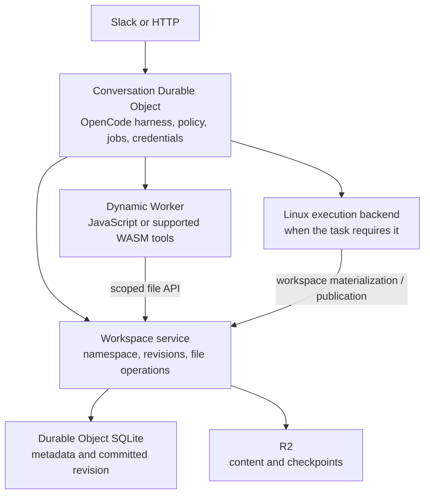

# WASM sandbox with durable storage — feasibility research

Research date: 2026-11-11. Status: retained research; experiment and runtime migration deferred by product-owner decision.

## Current planning decision

Keep OpenCode in Cloudflare Containers with stow-s3 and R2. Reliability, recovery,
tenant/credential isolation and onboarding take priority. No WASM, isolate or
alternative-runtime prototype is scheduled; the earlier two-day spike suggestion
is superseded. The [roadmap runtime direction and revisit gate](../roadmap.md#runtime-direction--retain-the-current-stack)
govern this note and its companion research.

The architecture, storage contracts and experiment below are conditional reference
material. Revisit them only when measured startup latency, idle cost or concurrency
limits justify a change. AgentOS-inspired jobs, recovery visibility, scoped
capabilities and explicit limits belong to the existing stack's roadmap tickets.

## Conclusion

Aboiteau can plausibly offer a persistent sandbox whose supported tools run entirely in isolates and WebAssembly. The platform primitives and useful integration seams exist. This is a source-backed feasibility conclusion, not proof that our complete workload can run there today.

The promising architecture is a trusted conversation supervisor, a durable workspace service, and replaceable execution backends. Storage identity should survive execution replacement. OpenCode can remain the harness. stow-s3 can remain the storage technology. AgentOS supplies useful concepts without requiring its runtime.

“Full sandbox” needs a workload definition. Durable files, bounded code execution, controlled networking, and a supported tool catalogue are feasible targets. Arbitrary Linux executables, native npm add-ons, unrestricted package installation, terminals, and existing build systems require separate compatibility evidence. WASM does not itself provide those capabilities or persist process memory.

## Findings that change the earlier assessment

### OpenCode already has a Worker runtime boundary

Our installed `runtime/opencode` locks `@opencode/server`, `@opencode/core` and related packages to 2.2.5. Its `server/dist/workerd.js` implements a Durable Object profile with SQLite storage, persistent events, and replacements for local services. Its declaration describes filesystem and process services as unavailable until an execution plane backs them. Native watchers, PTY and image-related modules have special bundle handling. We currently select the Node services in `runtime/opencode/server.ts`; that is our selected deployment, not an inherent requirement that OpenCode's loop live in a container. [OpenCode 2.2.5 workerd source](https://github.com/anomalyco/opencode/blob/v2.2.5/packages/server/src/workerd.ts)

Cloudflare also documents an OpenCode harness directly inside a Durable Object, using `OpenCodeWorkerd`, prefixed SQL tables, lifecycle recovery and bundled plugins. Its example explicitly removes local file and shell tools and registers replacements. The documented SDK route and our installed lower-level server route are related options; do not assume they are interchangeable without checking the chosen package versions. [Cloudflare OpenCode integration](https://developers.cloudflare.com/agents/harnesses/opencode/)

OpenCode's environment driver separates a process spawner from file-operation overrides. The file contract includes range reads, writes, stat, list, remove, move and mkdir, with explicit symlink behavior. This is a concrete adapter seam, although replacing the tool list alone may not cover filesystem routes, Git, snapshots, PTY, stdio MCP or all repository context discovery. [Environment driver](https://github.com/anomalyco/opencode/blob/v2.2.5/packages/core/src/environment/driver.ts), [file contract](https://github.com/anomalyco/opencode/blob/v2.2.5/packages/core/src/environment/files.ts)

### Cloudflare supports dynamic WASM and isolated durable guest state

The Worker Loader accepts Wasm modules, dynamically composed JavaScript, explicit bindings, and an outbound network policy. Its `get()` cache is not a persistence mechanism: later requests can start fresh isolates. Code/config changes require a new cache identity. Network access is inherited when `globalOutbound` is omitted; use an explicit policy. [Worker Loader API](https://developers.cloudflare.com/dynamic-workers/api-reference/)

Durable Object Facets give dynamically loaded classes separate SQLite databases under a supervisor. A supervisor can restart a facet while preserving its data, or explicitly delete it. This supplies persistent isolated application state; it does not automatically supply a POSIX filesystem or save a Wasm heap. Ordinary one-shot tool workers can instead call a trusted workspace service, avoiding a durable database per command. [Facet model](https://developers.cloudflare.com/dynamic-workers/usage/durable-object-facets/)

CPU and subrequest limits can be lowered per Dynamic Worker invocation. They must be combined with Aboiteau's own storage, output, wall-time, job and budget limits. Dynamic Workers also have context-level concurrency limits, so admission control remains necessary. [Custom limits](https://developers.cloudflare.com/dynamic-workers/usage/limits/), [concurrency limits](https://developers.cloudflare.com/dynamic-workers/platform/limits/)

Workers' built-in `node:fs` is a memory-based virtual filesystem; it is not our persistent workspace. It also lacks filesystem permissions and ownership. Durable storage must be deliberately connected to the guest's file API. Workers WASI support is experimental and incomplete, and threading is unavailable. A raw WASI binary is therefore not automatically compatible. [Workers filesystem](https://developers.cloudflare.com/workers/runtime-apis/nodejs/fs/), [Wasm and WASI support](https://developers.cloudflare.com/workers/runtime-apis/webassembly/)

## Deferred architecture option

### Stow already has a relevant WASM storage seam

Current upstream stow source, pinned to `506b4ed09033430adffe092a7a2f41110866487d`, exposes an asynchronous binary host-object bridge through `HostObjectStoreBridge.call` and `AsyncWasmBridge.openHost`. Its `ContentObjectHost` connects object operations to a content store; `ContentAdapter` separates content chunks and records from generation-bearing heads and publication. These are promising building blocks for durable workspace storage. They are upstream source capabilities, not proof that Aboiteau's native Stow 0.3.7 integration has a container-free backend. [WASM bridge](https://github.com/chester-hill-solutions/stow-s3/blob/506b4ed09033430adffe092a7a2f41110866487d/packages/stow-s3/src/wasm-bridge.ts), [content host](https://github.com/chester-hill-solutions/stow-s3/blob/506b4ed09033430adffe092a7a2f41110866487d/packages/stow-s3/src/content-object-host.ts), [adapter contract](https://github.com/chester-hill-solutions/stow-s3/blob/506b4ed09033430adffe092a7a2f41110866487d/packages/stow-s3/src/content-types.ts)

The missing qualification is explicit in Stow's proposed Workers ADR: it introduces no implemented platform profile or deployment certification. The existing browser worker host uses browser worker messaging and cannot be assumed to run unchanged on Cloudflare. Our experiment needs a supported Go WASM loading path, a DO/R2 adapter and a filesystem mapping above the object service. [Stow proposed Workers profile](https://github.com/chester-hill-solutions/stow-s3/blob/506b4ed09033430adffe092a7a2f41110866487d/docs/adr/0017-workers-profile-qualifies-platform-objects.md)

The most consequential integration issue is synchronous guest filesystem calls versus asynchronous storage. A Promise from an R2 call cannot simply stand in for a synchronous WASI syscall. Investigate a small preloaded working set with explicit write-set publication, or a qualified suspension/async ABI. An async Stow bridge solves its object-host boundary; it does not automatically solve every guest tool's filesystem ABI. [Emscripten async mechanisms](https://emscripten.org/docs/porting/asyncify.html), [WASI implementation gaps](https://github.com/cloudflare/workers-wasi)

AgentOS itself is currently a native host with embedded V8 and OS integrations. Its Wasm binaries can also require custom process/user/network imports beyond WASI. Its `chunked_s3` plugin stores blocks plus separate metadata, so attaching an S3 endpoint would not automatically expose the same raw file tree as our stow workspace. See the [pinned source investigation](agentos-storage-research.md) before reusing artifacts or mount adapters.

### Responsibility split

This is a proposed responsibility split, not a decision to duplicate existing storage. For the first experiment the current stow workspace remains authoritative; a container-free workspace backend must earn that role through durability and compatibility checks. Avoid allowing two independent stores to both claim to be the current writable workspace.

If guest applications need their own SQL state, evaluate facets. If a short command only needs workspace files, a fresh Dynamic Worker plus a narrow workspace binding is simpler. Keep model credentials, control credentials, budget records and permission decisions outside guest-accessible storage.

## Storage contract we need to prove

1. **Stable identity:** tenant, agent and conversation resolve to a workspace independently of the execution backend or process ID.
2. **Useful file semantics:** directories, binary bytes, range reads, rename/move, stat, symlinks and path confinement match the operations our tools actually require. S3 compatibility alone does not establish these semantics.
3. **One publication authority:** concurrent read/modify/write work uses a revision check or a serialized writer. A slow result cannot overwrite a newer workspace revision.
4. **Explicit durability:** a successful command reports the committed workspace revision. A staged object or cached write is not called durable until the authoritative metadata publication succeeds.
5. **Crash recovery:** termination between blob writes and revision publication leaves either the old complete revision or the new complete revision; abandoned data is reclaimable.
6. **Bounded working set:** avoid loading an entire repository and dependency tree into Wasm memory. Prove range/chunk access and maximum file/output/storage sizes.
7. **Backend handoff:** Linux changes become visible to lightweight execution through an explicit commit/materialization boundary. Do not claim concurrent shared POSIX access before testing it.
8. **Separate recovery domains:** conversation state, workspace revisions and process state have independent lifecycles. Restoring files must not imply a running build or terminal survived.

These are qualification questions for a future alternative workspace backend, motivated by existing checkpoint and revision concerns. They add no replacement-storage work to the current roadmap and are not claims that a specific external package implements all of them.

## What to borrow from AgentOS

| Concept | Aboiteau adaptation | Place in current work |
| --- | --- | --- |
| Trusted capability broker | Typed file/network/integration APIs with credentials kept in the supervisor | Refine R1-7, then prove against repository-controlled code |
| Jobs independent of chat messages | Job identity, execution generation, status, cursor-based output, cancellation, explicit unknown/interrupted result | R1-3/R1-4 inspection/events, R2-4 visibility; retain current runtime ownership |
| Bounded resources | Storage/output/time/process limits, structured near-limit and exhausted-limit events | R1-8 quotas, R2-4 visibility and R3-9 guardrails |
| Declarative environment | Versioned configuration; pin applied environment per turn | Keep SandboxSpec in R3-1/R3-8 |
| Explicit sleep/recreation semantics | Preserve verified checkpoints; mark lost live processes; reconcile interrupted work before retrying side effects | Existing R0 recovery, R1-3 lifecycle and R3-6 policy |
| Scoped previews | Expiring, revocable links associated with a specific process generation | Keep in planned R4 scope |

AgentOS documents typed host functions, scoped permissions, process generation identifiers and output replay, resource bounds, and persistence that excludes live processes. These are concepts we can implement using our current platform. [Host functions](https://rivet.dev/agentos/docs/host-functions/), [permissions](https://rivet.dev/agentos/docs/permissions/), [processes](https://rivet.dev/agentos/docs/processes/), [limits](https://rivet.dev/agentos/docs/resource-limits/), [persistence](https://rivet.dev/agentos/docs/persistence/)

## Conditional experiment after the revisit gate

This experiment is deferred. If the roadmap revisit gate is met, first define the
measured bottleneck and success target, then select the smallest suitable runtime;
JavaScript isolates may suffice. The WASM-specific checks below apply only if WASM
is selected. Use an isolated local proof and, only when necessary for platform-specific
behavior, a separate development deployment.

1. Start the installed OpenCode workerd profile in a test Durable Object using a deterministic fake model or tool fixture. Persist one session and replay its events after recreation. Check bundling, startup and memory before promising a migration.
2. Give a separate Dynamic Worker one deliberately narrow workspace binding. Prove read/edit/list of a small repository fixture and refusal of access to the supervisor's state. Start with native JavaScript for the binding contract.
3. Execute one prebuilt, pinned Wasm tool that reads and writes that workspace through the intended ABI. Include a binary file, a range read and an error path. An arithmetic-only Wasm demo would not answer the storage question.
4. Use stow's actual embedded host-storage seam if it satisfies the contract. Recreate the executor and storage service and confirm committed bytes remain. An in-memory save/reopen within the same process is insufficient.
5. Interrupt execution during a save and during an external side effect; show that recovery identifies committed state and does not blindly re-run an unknown result.
6. Record bundle size, startup latency, peak memory, per-operation storage calls, bytes transferred and tool compatibility. Compare the same small task against today's Linux backend without extrapolating vendor benchmarks.

**Proceed** if a real file-editing Wasm workload survives recreation, remains isolated, has bounded memory and publishes one authoritative revision. **Keep the backend experimental** if it requires whole-workspace copies, ambiguous durability, unsupported synchronous I/O, or loses essential OpenCode behavior. Expand the supported tool catalogue incrementally after the first result.

## Further useful research

- Extism's JavaScript SDK explicitly supports Cloudflare Workers and is worth testing for small compiled plugin functions with narrow storage imports. Jco/component shims are another interoperability option. Neither provides a complete agent filesystem/process environment merely by importing the package. [Extism JavaScript SDK](https://github.com/extism/js-sdk), [Jco](https://github.com/bytecodealliance/jco)
- Python Workers already use CPython compiled to Wasm through Pyodide. This is useful for data and document workloads, with package/runtime compatibility checked individually. Dynamic Workers documents Python support but warns about its startup cost for one-shot execution. [Python implementation](https://developers.cloudflare.com/workers/languages/python/how-python-workers-work/), [loader module types](https://developers.cloudflare.com/dynamic-workers/api-reference/)
- Wasmtime and WasmEdge are alternatives for a native host running restricted Wasm jobs. Wasmer's browser path requires Web Workers/shared memory, which is not evidence of Cloudflare Workers compatibility. Retain these as alternative execution-host investigations rather than an assumed way to port an OS into an isolate. See the [runtime comparison](wasm-runtime-options-research.md) for primary sources and boundaries.
- Cloudflare Computer already separates a SQLite-backed workspace from container, isolate-shell and isolate-JavaScript execution. Its filesystem tooling and backend contract are useful reference designs even if we retain stow. The shell backend uses just-bash, which is a JavaScript implementation rather than proof of a complete Wasm OS. [Computer repository](https://github.com/cloudflare/computer), [filesystem tooling](https://developers.cloudflare.com/agents/tools/filesystem/)
- Cloudflare Artifacts provides versioned file trees and session/branch workflows. It is relevant to later forks, comparisons and PR review, not a prerequisite for persistent Wasm execution. ArtifactFS is a separate FUSE-based local mount and should not be confused with an isolate storage adapter. [Artifacts](https://developers.cloudflare.com/artifacts/), [ArtifactFS](https://developers.cloudflare.com/artifacts/guides/artifact-fs/)

## Evidence and remaining work

This note is based on primary documentation, versioned OpenCode source and inspection of the installed 2.2.5 packages plus our runtime/control server. No Wasm execution, persistence, isolation or performance experiment has been run as part of this research. No production code, runtime dependencies, configuration or deployment was changed.

Companion investigations contain detailed runtime and stow/AgentOS source findings:

- [WASM runtime options](wasm-runtime-options-research.md)
- [AgentOS and stow storage](agentos-storage-research.md)

The current recommendation is to retain the existing runtime and execute the roadmap's reliability, isolation and onboarding work. Keep this research available for a measured future need. Credential boundaries, job inspection, recovery visibility and explicit limits can improve the product within the current stack.
